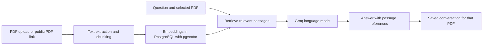

# PaperPilot

**A focused AI reading workspace for asking questions about PDFs.**

PaperPilot lets you build a personal document library, choose the PDF you want to discuss, and ask questions grounded in its content. It combines retrieval-augmented generation (RAG) with per-document conversations, so answers are based on passages retrieved from the selected PDF.

## What it does

- Upload a PDF or add a public PDF link.
- Keep multiple PDFs in a searchable library and select which one to ask about.
- Ask follow-up questions in conversations saved for each document.
- Retrieve relevant passages from the selected PDF and ask the language model to answer from that evidence.
- Request summaries, explanations, key points, and study questions.
- See document indexing status and errors while a PDF is being prepared.
- Create an account and return to saved documents and conversations.

## How it works

1. PaperPilot stores the uploaded PDF and creates a separate vector collection for that document.
2. It extracts selectable text, splits it into overlapping chunks, and creates embeddings.
3. When you ask a question, PaperPilot searches the selected document’s collection for relevant passages.
4. The language model receives those passages and instructions to answer from the selected PDF, avoid guessing when evidence is missing, and cite supporting passages with labels such as `[Passage 1]`.
5. The conversation is saved and associated with that document.



## Technology

- **Frontend:** React, TypeScript, Vite
- **Backend:** Python, FastAPI, SQLAlchemy
- **Database and vector search:** PostgreSQL, pgvector
- **RAG framework:** Phidata
- **Language model:** Groq API; the model is configurable
- **Embeddings:** FastEmbed locally by default, or OpenAI when configured
- **Local deployment:** Docker Compose, with PostgreSQL/pgvector and Nginx

## Run locally with Docker

You’ll need Docker Compose and a Groq API key.

1. Copy `backend/.env.example` to `backend/.env`.
2. Add your `GROQ_API_KEY` to `backend/.env`. For database credentials, create a root `.env` file and set a strong `POSTGRES_PASSWORD`.
3. Start the services:

   ```bash
   docker compose up --build
   ```

4. Open [http://localhost:8080](http://localhost:8080). Video deployed Demo[https://paper-pilot-ss9w-ten.vercel.app/]

OpenAI embeddings are optional. With `EMBEDDER=auto`, PaperPilot uses OpenAI embeddings when `OPENAI_API_KEY` is configured; otherwise it uses FastEmbed. The Groq API is still used to generate answers.

## Supported documents and current limits

- PaperPilot currently accepts **PDF files** and public URLs that point directly to a PDF.
- Uploaded PDFs have a default **50 MB** limit, configurable with `MAX_UPLOAD_MB`.
- PDFs need selectable text. Scanned or image-only PDFs must be OCR-processed before upload.
- PowerPoint and other office files are not accepted directly; export them to a text-searchable PDF first.
- Passage references identify retrieved text, but they are not page-number citations.
- The default request budget is shared across users of one deployment and can be changed with `REQUEST_LIMIT`.

## Data and service notes

Uploaded PDF bytes, document metadata, vector data, and conversation history are stored using the configured database and assistant services. Depending on configuration, document text may be sent to OpenAI for embeddings, and retrieved passages are sent to Groq to generate answers. Review your providers’ data policies before uploading sensitive documents.

## Project structure

```text
backend/
  app/              FastAPI routes, authentication, PDF indexing, retrieval, and chat
  tests/            Backend tests
frontend/
  src/              React application and UI components
legacy/              Earlier command-line PDF assistant
docker-compose.yml   Local PostgreSQL/pgvector, backend, and frontend services
```

## Development status

PaperPilot is an actively developed project. Current work focuses on making document selection, PDF indexing, and retrieval dependable across multiple files and larger documents. OCR for scanned PDFs, page-number citations, and richer retrieval evaluation are potential next steps.
